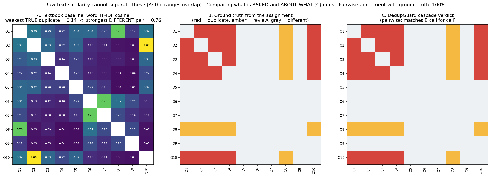
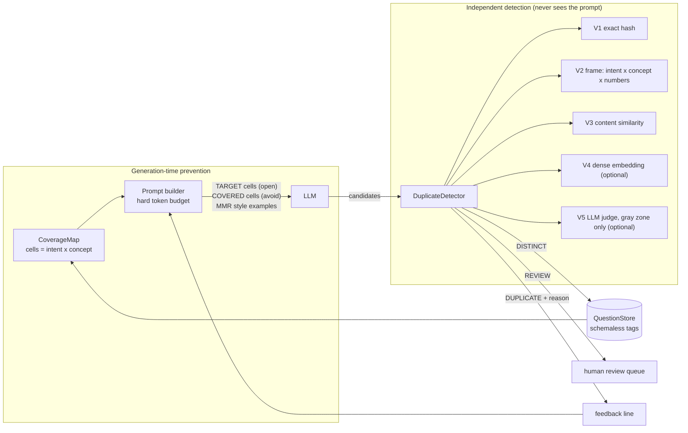

# DedupGuard - duplicate-free AI question generation

**Assignment:** Question 2 - *AI Question Generation and Duplicate Prevention*
**Stack:** pure Python 3.10+ standard library. `matplotlib`/`numpy` are only used to draw the figure.

```bash
python demo.py                      # guided tour on the reflection-of-light corpus (10 s)
python -m unittest discover -s tests   # 22 tests
python evaluate.py                  # full evaluation: baselines, stress set, metamorphic suite, 50k-question scale test
```

---

## 1. The idea 

Duplicate questions are not a *wording* problem, they are a *meaning* problem, and the two obvious tools fail in opposite directions.
String/embedding similarity flags **"State the laws of reflection of light"** as a duplicate of **"What is reflection of light?"** (they share 4 of 5 content words) while missing that **"Explain the meaning of light reflection"** *is* one.
So I stopped asking *"how similar are these strings?"* and ask instead: **"do these two questions ask for the same thing, about the same thing?"**
Every question is parsed into a small **frame** - `(intent, concept, given-numbers)` - and frames are compared structurally. That one representation drives *both* halves of the system:

* **Prevention** - the corpus is folded into a grid of *cells* (kind-of-ask × concept). The LLM is told which cells are **open** (generate into these) and which are **covered** (stay out). Prompt size depends on the number of *ideas*, not the number of questions.
* **Detection** - a separate cascade of decorrelated voters (exact hash · frame · content similarity · optional dense embedding · optional LLM judge) vets every candidate, and does so even if prevention was bypassed or failed.



*(A) Textbook word-TF-IDF cosine on the assignment corpus: the weakest true duplicate scores 0.14 while a genuinely different pair (Q6/Q7) scores 0.76 - no threshold works. (B) Ground truth from the assignment. (C) The cascade, pairwise, matches B in every cell.*

---

## 2. Architecture



| file | role |
|---|---|
| `normalize.py` | canonicalisation: case, punctuation, unicode, `Q3.`/`[2 marks]`/MCQ options, `thirty` → `30`, `7 centimetres` → `7 cm`, light lemmatiser |
| `frame.py` | **the core**: rule-based intent + head-noun/modifier concept parser, and the structural comparator |
| `embed.py` | stateless, IDF-free content vectors (append-only index) + `DenseEmbedder` adapter for neural models |
| `index.py` | `QuestionStore` with exact / head-noun / inverted indexes → sub-linear candidate retrieval; tags are stored, never consulted |
| `detector.py` | the voter cascade, evidence trail, `audit()` for scanning an existing bank |
| `coverage.py` | coverage map, open-cell computation, MMR exemplars, hard-budget prompt packer |
| `generate.py`, `llm.py` | generate → verify → feedback loop; `AnthropicLLM`, `LLMJudge`, and a `MockLLM` simulator |

---

## 3. Independent duplicate detection 

### 3.1 What a frame is

| question | intent | concept (head + modifiers) | numbers |
|---|---|---|---|
| What is reflection of light? | DEFINE | **reflection** + {light} | |
| Explain the meaning of light reflection. | DEFINE | **reflection** + {light} | |
| State the laws of reflection of light. | ENUMERATE | **law** + {reflection, light} | |
| What is the angle of reflection? | DEFINE | **angle** + {reflection} | |
| The angle of incidence is 30°. What is the angle of reflection? | COMPUTE | **angle** + {reflection} | {30°} |
| What is reflection? | DEFINE | **reflection** + {} | |
| …difference between regular and diffuse reflection? | DIFFERENTIATE | bag {regular, diffuse, reflection} | |

Linguistic facts doing the work: *"X of Y"* → head X; compound *"Y X"* → head X (so *light reflection* ≡ *reflection of light*); *"what **are** the laws/types/properties of…"*, *"list…"*, *"state the laws…"* are all enumerations; *"meaning/definition/term/concept of"* are cues, not content; numbers are matched as values with normalised units.

### 3.2 How two frames are compared

| intent | concept relation | verdict |
|---|---|---|
| same | same | **DUPLICATE** (for COMPUTE: also needs identical given values) |
| same (COMPUTE) | same, *different numbers* | DISTINCT, flagged `numeric_variant` |
| same | one is a strict sub-/super-set (`reflection` vs `reflection of light`) | **REVIEW**, with the differing qualifier named |
| same | different head (`angle` vs `reflection`) or disjoint modifiers (`speed of light in vacuum` vs `in glass`) | DISTINCT |
| adjacent (`DEFINE`↔`EXPLAIN`) | same | REVIEW |
| different | - | DISTINCT |
| compound ("what is X **and why** Y") | any sub-question overlaps | REVIEW |

### 3.3 Why a cascade, and how the voters keep each other honest

| voter | catches | blind spot it is paired against |
|---|---|---|
| V1 exact hash | formatting, case, punctuation, numbering, marks, MCQ options | any rewording |
| V2 frame | paraphrase; **veto** on look-alikes | shapes the parser doesn't recognise (it *abstains* - low confidence) |
| V3 content cosine | what V2 can't parse; near-identical text V2 called distinct (→ escalates to REVIEW) | false friends (that's why it never overrides a *confident* V2) |
| V4 dense (optional) | extra paraphrase recall | topical clustering (same weakness as V3, so it can only *promote* a case that is already ambiguous) |
| V5 LLM judge (optional) | gray-zone arbitration; called **only** on REVIEW, so cost is bounded | cost/latency - hence the gating |

Every verdict carries an **evidence trail** (`verdict.explain()`):

```
Q5: 'State the laws of reflection of light.'          <- shares 4 of 5 content words with Q1
   DISTINCT  (confidence 0.95)   frame=ENUMERATE|light reflection law
     vs Q1: 'What is reflection of light?' -> DISTINCT (0.95) sim=0.83
          [exact  ] no        texts differ after canonicalisation
          [frame  ] DISTINCT  different ask: ENUMERATE vs DEFINE
          [lexical] REVIEW    content cosine 0.83          <- overruled by a confident frame
```

**Independence:** `detector.py` imports nothing from `coverage`, `generate` or `llm` (enforced by a test). It needs only a list of questions, so it also works on human-authored imports, other LLMs, or a nightly `audit()` of the whole bank.

---

## 4. Generation-time avoidance

**Context limits - fold, don't dump.** A corpus of N questions becomes (#distinct cells) lines. A cell with 5 paraphrases is one line with a count and one example. The prompt packer enforces a **hard token budget** by priority: header › TARGET cells › feedback › COVERED cells › style examples (it sheds from the bottom until it fits; always keeps ≥1 target). Relevant cells are found with the inverted index (top-k neighbours of the subject), never a full scan.

**Same meaning, different words.** Cells are keyed by *frame*, not by text, so every paraphrase of "define reflection" collides in one cell by construction. We then ask the LLM to fill *open* cells (slot-filling) rather than asking it to "avoid these 4,000 strings" (blacklisting) - blacklists anchor the model on the very wording you want it to avoid.

**Scaling.** Measured on a 50,000-question synthetic bank:

| N | detector p50 | p95 | recall of planted paraphrases | false-positive rate | guided prompt | "paste everything" prompt |
|---:|---:|---:|---:|---:|---:|---:|
| 1,000 | 1.9 ms | 3.0 ms | 100% | 0% | 899 tok | 9,550 tok |
| 5,000 | 2.4 ms | 3.5 ms | 100% | 0% | 898 tok | 47,703 tok |
| 20,000 | 3.1 ms | 5.1 ms | 100% | 0% | 894 tok | 190,500 tok |
| 50,000 | 5.4 ms | 7.6 ms | 100% | 0% | 892 tok | 477,448 tok |

(single thread, pure Python, this sandbox; ≈ 43 candidates examined per query at 50k. Recall/FPR here only verify that *retrieval pruning doesn't lose duplicates as N grows* - the planted paraphrases come from my own templates, so it says nothing about paraphrase *understanding*.)
Mechanisms: exact-hash O(1) · head-noun bucket · inverted index with common-feature pruning (a stop-word list for char-grams) · IDF-free vectors so nothing is re-embedded when the corpus grows · incremental coverage map. Past ~10⁶ questions swap the in-memory index for Postgres + pgvector/HNSW or Elasticsearch behind the same `candidates()` interface.

**Open slots come from facets.** A *facet* is a sub-topic of the subject (`plane mirror`, `periscope`…). In production one cached LLM call proposes the facets per subject; the demo passes them in. Open cells are interleaved so early slots vary in *both* intent and facet (no eight "define X" questions).

**The loop** (`generate.py`): prompt → LLM → vet each candidate with the detector (which also sees everything accepted earlier in the same run, so intra-batch duplicates are caught) → accept `DISTINCT` / hold `REVIEW` / reject duplicates → rejected items are fed back as compact lines ("*'…' repeats Q11 (WHY | laws of reflection of light) - pick a different cell*") → next round asks only for the shortfall.

---

## 5. Tags and metadata

Tags are an arbitrary `dict` per question - new keys and values need no schema change. They are **stored but never read by the detector**: a duplicate is found across any tag combination (including no tags), and identical tags never create a false duplicate (`TestTagsDoNotDecide`). They may be used for UI filtering or to scope the coverage digest, but decisions come from content only.

---

## 6. Results on the assignment's test data 

Protocol: each question is classified against all questions before it.

| id | question | expected | got |
|---|---|---|---|
| Q1 | What is reflection of light? | Original | Original |
| Q2 | Define the reflection of light. | Semantic dup of Q1 | ✅ Semantic dup (Q1) |
| Q3 | What do you understand by the reflection of light? | Semantic dup of Q1 | ✅ Semantic dup (Q1) |
| Q4 | Explain the meaning of light reflection. | Semantic dup of Q1 | ✅ Semantic dup (Q1) |
| Q5 | State the laws of reflection of light. | Different | ✅ Distinct |
| Q6 | What is the angle of reflection? | Different | ✅ Distinct |
| Q7 | The angle of incidence is 30°. What is the angle of reflection? | Different | ✅ Distinct |
| Q8 | What is reflection? | Review | ✅ Review - *"candidate is broader: differs only by ['light']"* |
| Q9 | …difference between regular and diffuse reflection? | Different | ✅ Distinct |
| Q10 | Define the reflection of light. | Exact dup of Q2 | ✅ Exact dup (Q2) |

**10/10.** Full transcript: `demo_output.txt`.

### Honest evaluation beyond the 10 questions

The assignment data alone proves little (I could have fitted 10 questions), so `evaluate.py` adds:

1. **Stress set - 58 hand-labelled pairs** across biology, maths, chemistry, SQL, history, physics: 25 duplicates (formatting, paraphrase, 2 deliberately hard), 26 hard negatives (high word overlap, different meaning), 5 ambiguous.
2. **Baselines with oracle-tuned thresholds** - each gets the *best possible* threshold, an advantage a real system never has.

| method | F1 (dup vs different) | precision | recall |
|---|---:|---:|---:|
| difflib ratio | 0.68 | 0.53 | 0.96 |
| word TF-IDF cosine | 0.71 | 0.55 | 1.00 |
| my content cosine (V3 alone) | 0.84 | 0.74 | 0.96 |
| **DedupGuard cascade** (strict: REVIEW ≠ dup) | **0.96** | **1.00** | 0.93 |
| DedupGuard (lenient: REVIEW counts as flagged) | 0.98 | 1.00 | 0.96 |

3-way accuracy (DUP / REVIEW / DISTINCT) **56/58 = 97%**; 26/26 hard negatives; 5/5 ambiguous; 20/20 paraphrases; 5/5 format noise.
**Both misses are shown, not hidden:** `capital of France` vs `France's capital city` (my "last noun is the head" rule picks *city*) and `renewable energy` vs `renewable energy sources` (the extra noun is read as a new head → REVIEW, not DUP).

3. **Metamorphic suite - 2,992 generated checks**, all passing: format noise ×6 variants, 8-way paraphrase templates, intent shifts, concept shifts across 24 concepts.

#### What these numbers do **not** prove
* I wrote the stress set *while knowing the parser's rules*, and while drafting it I patched five generic gaps it exposed (unit aliases, `what causes X`→WHY, `name X`, `non-` prefixes, light verbs). It is therefore a **development set, not a blind benchmark**. Expect lower numbers on questions written by strangers.
* The metamorphic suite shares an author with the rules: it guards **regressions and invariances**, not external validity.
* **I could not test against a neural embedder or a real LLM** - the sandbox had no network. `DenseEmbedder`, `AnthropicLLM` and `LLMJudge` are written against the documented interfaces and exercised only with stubs. `MockLLM` is a *behavioural simulation*; its "guided beats plain" demo shows the pipeline and safety net work, **not** how often a real model repeats itself.
* Latency numbers are single-thread pure Python in a sandbox.

---

## 7. How I would evaluate this for real

1. **Labelled pair set from production data.** Sample candidate pairs *stratified by detector score* (not at random - dups are rare) plus all REVIEW verdicts. Have 2-3 teachers label {same / different / same-but-not-worth-keeping}; report inter-annotator agreement (Cohen's κ) - it caps achievable accuracy. Target ≥1,500 pairs; refresh quarterly.
2. **Asymmetric metrics.** A false *reject* wastes one LLM call; a false *accept* ships a duplicate to students. Track **recall of true duplicates at fixed precision ≥ 0.98**, the **REVIEW rate** (human cost), and calibration of `confidence` (reliability diagram).
3. **Generation-side metric:** duplicate rate of *accepted* questions found by a later offline audit with a stronger judge (LLM + human spot check), plus **first-pass acceptance rate** and **LLM calls per accepted question** (cost), A/B-ing the coverage-map prompt against a plain prompt using the real model.
4. **Shadow mode first:** run the detector on live traffic without blocking, diff against human decisions, then enable.
5. **Robustness:** extend the metamorphic suite (typos, translation round-trips, MCQ re-ordering), and mine *disagreements between voters* as the highest-value labelling queue.
6. **Performance:** p50/p95/p99 latency and memory at 10⁵-10⁶ questions, load test with concurrent writers.

---

## 8. Trade-offs, known limits, and what I'd do next

| decision | why | cost |
|---|---|---|
| **Rule-based frame parser** instead of an LLM call per comparison | deterministic, auditable, ~0 latency/cost, easy to unit-test; every verdict has a reason | English only; unseen question shapes get a low-confidence frame and *abstain* to V3 instead of guessing; head-noun heuristic fails on some compounds (see misses) |
| **Frame veto over similarity** | similarity is the classic false-positive generator ("laws of X" vs "what is X") | if the parser is *confidently wrong* it can veto correctly-high similarity. Mitigations: V3 safety-net escalation, optional judge, nightly `audit()`, shadow-mode diffing |
| **Correlated failure risk:** prevention and V2 both use frames | one representation gives one coherent notion of "same idea" | a parser bug could affect both. Detector still has V1/V3 (and V4/V5) that don't use frames |
| **REVIEW as a first-class outcome** | `reflection` vs `reflection of light` is genuinely context-dependent (the assignment itself says so) | adds a human queue; `review_policy` = `hold` / `accept` / `reject` is configurable |
| **IDF-free vectors** | append-only index, no re-embedding as the corpus grows | slightly weaker lexical ranking than IDF-weighted |
| Numeric variants → DISTINCT + flag | different answer ⇒ different question; but teachers may still want to cap template reuse | flag exposed (`numeric_variant`); policy left to caller |
| MCQ options stripped before comparison | two MCQs with the same stem but different distractors are the same *concept* | a stem-identical MCQ with a different *correct answer* is not distinguished |

**Next steps:** (1) plug in a real embedder + judge and measure the V4/V5 lift on the labelled set; (2) distil the rule parser's labels (plus LLM-labelled hard cases) into a small multilingual intent/concept tagger to widen coverage; (3) concurrency: make *check-then-add* atomic (DB unique constraint on exact key + re-check inside the transaction) so two workers can't both insert the same new idea; (4) version frames so a parser upgrade triggers re-indexing; (5) expose `numeric_variant` / template-reuse caps as a policy knob.

---

## 9. Using it with a real model

```python
from dedupguard import DuplicateDetector, QuestionGenerator, AnthropicLLM, LLMJudge
from dedupguard.embed import DenseEmbedder           # optional
# from sentence_transformers import SentenceTransformer
# m = SentenceTransformer("all-MiniLM-L6-v2"); dense = DenseEmbedder(lambda xs: m.encode(xs, normalize_embeddings=True))

llm = AnthropicLLM()                                  # needs `pip install anthropic` and ANTHROPIC_API_KEY
det = DuplicateDetector(judge=LLMJudge(llm))          # add dense=dense to enable V4
for text, tags in load_existing_questions():          # tags: any dict, any keys
    det.add(text, tags)

gen = QuestionGenerator(det, llm, budget_tokens=900, review_policy="hold")
report = gen.generate("reflection of light", n=10, facets=["plane mirror", "periscope", ...])
print(report.summary())
for v in report.held_for_review: print(v.explain())

det.check("Define osmosis.").explain()                # standalone, no generator involved
det.audit()                                           # duplicate clusters in an existing bank
```
